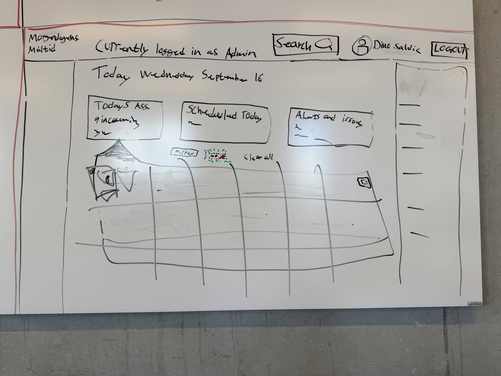

## Start by refusing to guess

In the AIDA Mini AI Hero workflow, Grill Me comes before specifications and code. The purpose is to challenge an incomplete brief through short rounds of customer questions. After each round, the team summarizes what is now known, which terms belong in the glossary, which choices need a written decision note, and which open questions still block a reliable spec.

The available project material does not contain a complete interview transcript. Instead of inventing one, I began with evidence from the sketches, design, current code, GitHub issues, pull requests, and tests.

## What the artifact tells us

The sketches and React prototype consistently describe a scheduling product for Morgendagens Måltid. There are two roles: administrator and employee. Work is divided into kitchen and cleaning teams. Assignments have a time, location, required staffing level, and assigned employees. Administrators need to see staffing gaps, availability, time off, weekly hours, and issues. Employees need their own schedule, open spots, notifications, and self-service requests.

Those are observable facts about the prototype, not proof that a customer approved every decision.

## Grill Me round one

The first five questions should test the product's foundation:

1. Who creates the schedule today, and what is most difficult about that process?
2. Which roles use Supavisor, and what information must each role never see?
3. What is the difference between an assignment, a shift, a project, and a location in the customer's language?
4. Which scheduling rules are legal or contractual requirements, and which are only warnings?
5. What must happen when an employee becomes unavailable after a schedule is published?

The current prototype suggests answers, but the customer still needs to confirm them.

## Grill Me round two

The next questions target workflows already represented in the UI:

1. Does an employee request an open spot, or can they claim it immediately?
2. Who approves time off and shift changes, and what statuses are required?
3. Which notifications are essential, and through which channels should they arrive?
4. Should administrators see medical reasons, or only operational absence information?
5. Which dashboard numbers must be live, and how quickly must they update?

## What this changes

Without Grill Me, a polished screen can hide unverified assumptions. Supavisor already demonstrates a strong product direction, but its next specification should be based on customer answers rather than on labels inferred from the prototype. The immediate output of this step is therefore not more code. It is a list of confirmed facts, glossary candidates, decision candidates, and blockers.

[AIDA source: Grill the customer in the Mini AI Hero flow](https://aida.kursusmaterialer.dk/07-spec-driven-dev/mini-ai-hero-quiz-oevelse/)
