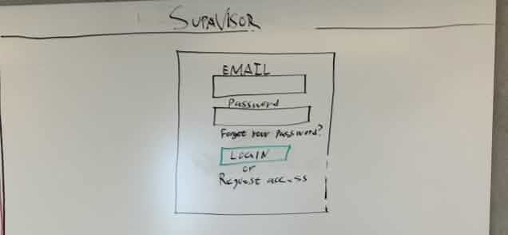
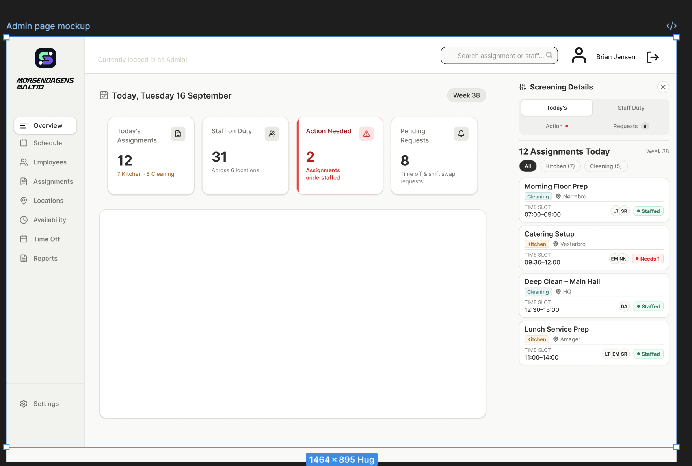

## Using the documented specification

The backend repository contains a ready-for-agent specification at `.scratch/project-management-tool/spec.md`, supported by a user-story priority and blocker map, a Figma slice map, and the engineering conventions in `contributing.md`. These documents define the intended React frontend, Java/Javalin REST backend, PostgreSQL persistence, Hibernate mappings, domain model, delivery priorities, and testing boundaries. This article summarizes that written baseline and compares it with the implementation; it does not reconstruct a missing specification.

No customer interview was recorded, so the specification is evidence of the team's documented product decisions rather than an interview transcript. Any behavior not settled by the specification, issues, or tests still needs explicit confirmation instead of being inferred from a screen or generated implementation.

AI-assisted tools were used during design and implementation. They helped turn ideas and visual directions into React pages, supported the Figma conversion, and assisted with debugging and backend work. AI is therefore part of the development method, but not part of Supavisor's runtime product behavior. The application itself does not currently call a model or expose an AI feature to administrators or employees.

## Remaking the Figma output for the real frontend

The Figma-generated starting point could not simply be copied into the repository. It began as TSX, while this frontend is implemented with React and JSX. I used AI assistance to translate the TSX into JSX, repair syntax and import differences, and work through styling problems. I also read the relevant documentation rather than treating generated code as authoritative.

The styling needed a second conversion. Broad generated CSS was reorganized into CSS Modules so styles could stay close to their page or component without leaking across the application. The current frontend reflects that result: pages such as the login screen, administrator dashboard, and employee overview are `.jsx` files that import their own `.module.css` files. AI accelerated the remake, but manual review, documentation, and testing were what made it fit the project.

## Problem

Scheduling work across employees, teams, assignments, locations, availability, and leave can make staffing gaps and conflicts difficult to see. Supavisor aims to give administrators an operational overview and employees a clear personal schedule.

## Users

- Administrators who plan and monitor work.
- Employees who review shifts and submit scheduling-related requests.

## Goals demonstrated by the current project

- Separate administrator and employee experiences and enforce sensitive boundaries on the backend.
- Let administrators manage users, roles, permissions, employee categories, qualifications, projects, tasks, assignments, resources, and expenses.
- Let employees inspect their own profile and assignment information and take permitted actions.
- Preserve assignment state history and important responsibility changes.
- Reject stale schedule updates instead of silently overwriting newer work.
- Persist business data and verify important behavior with automated tests.

## Non-goals and claims this portfolio does not make

- Supavisor does not currently provide an AI assistant, model integration, RAG pipeline, or automated AI scheduling.
- The portfolio does not claim that every open GitHub issue is finished or every frontend path is fully connected.
- It does not claim payroll calculations, email/SMS/push delivery, offline operation, GPS check-in, or legal-compliance guarantees.
- It does not treat a completed screen as proof that authorization, persistence, and concurrency are complete.

## Primary administrator flow

1. Authenticate as an administrator.
2. Open the relevant management area, such as assignments, users, projects, roles, or qualifications.
3. Load data through the frontend service layer.
4. Create or update a permitted resource.
5. Let the backend validate authorization, state, timing, and concurrency rules.
6. Show the saved result or a clear conflict, validation, or forbidden message.

## Primary employee flow

1. Authenticate as an employee.
2. Open the employee overview or assignment details.
3. See only the information allowed for that identity.
4. Take an action such as acknowledging an eligible future assignment.
5. Receive a clear result and see the persisted state and history after refresh.

## Design requirements visible in the implementation

The remade interface should preserve the intent of the Figma design while fitting the real component structure. CSS Modules should keep page styles scoped. Warnings and states must remain understandable without relying only on color. Administrator density and employee simplicity should remain distinct, and responsive layouts should keep the main actions usable.

## Remaining validation

The written specification resolves much of the domain vocabulary and intended behavior, but it is not a recorded customer conversation. Future Grill Me work should validate that the documented baseline still reflects stakeholder intent, especially around override policy, privacy boundaries, configurable statuses, notification expectations, and whether organization-level roles remain sufficient. New behavior should be recorded as an explicit scope change rather than inferred from the interface.

[AIDA source: Writing the spec in the Mini AI Hero flow](https://aida.kursusmaterialer.dk/07-spec-driven-dev/mini-ai-hero-quiz-oevelse/)
